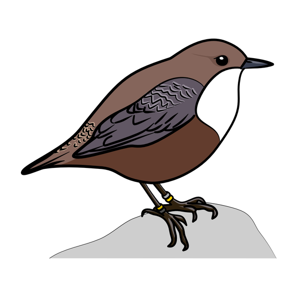

<!-- TODO: Projektträger, Projektleitung und Partner ergänzen und Angaben zum Monitoring prüfen -->

::: {.hero}
::: {}
[Die Wasseramsel – rätoromanisch *Merl da l'Ova* – lebt das ganze Jahr am Spöl. Als einziger Singvogel taucht sie nach Insektenlarven am Bachgrund. Wir begleiten sie während und nach der Sanierung des Spöl und wollen wissen, wie es ihr geht. **Dafür brauchen wir Ihre Beobachtungen.**]{.lead}

[Wasseramsel gesehen? Jetzt melden](beobachtung.qmd){.cta}
[Mehr zur Sanierung](#sanierung){.cta .secondary}
:::
{fig-alt="Zeichnung einer Wasseramsel mit Farbringen"}
:::

## Die Sanierung des Spöl {#sanierung}

Der Spöl fliesst vom Stausee Livigno durch den Schweizerischen Nationalpark. Im Herbst 2016 gelangten bei Korrosionsschutzarbeiten an der Staumauer Punt dal Gall polychlorierte Biphenyle (PCB) in den Bach. PCB sind langlebige Umweltgifte, die sich im Sediment und über die Nahrungskette in Tieren anreichern.

::: {.timeline}
::: {}
**2016** – PCB gelangt bei Arbeiten an der Staumauer Punt dal Gall in den Spöl.
:::
::: {}
**August 2025** – Vorbereitungsarbeiten: Installationsplatz an der Staumauer, rund 12 000 Fische werden umgesiedelt. Der Wanderweg ab der Staumauer ist bis mindestens Ende 2026 gesperrt.
:::
::: {}
**ab Frühling 2026** – Auf rund 3 km (Abschnitte 1–3) wird das Bachbett ausgebaggert. Das PCB-belastete Feinsediment wird abgetrennt und thermisch entsorgt, das gereinigte Material kommt zurück in den Bach.
:::
::: {}
**danach** – Der untere Abschnitt (rund 2,5 km) soll mit gezielten Hochwassern gespült werden. Ob auch die Strecke bei der Mündung der Ova dal Fuorn saniert werden muss, entscheiden die Behörden anhand von Proben.
:::
:::

## Warum die Wasseramsel?

Die Wasseramsel steht am oberen Ende der Nahrungskette im Bach. Sie frisst Köcherfliegen-, Steinfliegen- und Eintagsfliegenlarven, die am und im Sediment leben, also genau dort, wo das PCB sitzt. Studien aus Grossbritannien und Irland zeigen, dass sich PCB in Wasseramsel-Eiern nachweisen lässt. Die Art gilt deshalb als guter Anzeiger für den Zustand eines Fliessgewässers.

Die Sanierung greift zudem stark in den Lebensraum ein: Das Bachbett wird umgebaut und die Insektenlarven müssen den Bach neu besiedeln. Wir möchten verstehen:

- Bleiben die Wasseramseln in ihren Revieren oder weichen sie aus?
- Wie viele überleben und brüten während und nach den Bauarbeiten?
- Wie schnell wird der sanierte Spöl wieder besiedelt?

## Jede Wasseramsel hat einen Namen

Die Wasseramseln am Spöl tragen eine individuelle Kombination aus **Farbringen**. Daran lässt sich jeder Vogel mit dem Feldstecher erkennen, ohne ihn erneut zu fangen. Jedes Individuum hat einen Namen. Jede Ablesung zeigt uns, dass ein bestimmter Vogel an einem bestimmten Ort lebt.

## So helfen Sie mit

::: {.steps}
::: {}
[1]{.num}

**Beobachten.** Schauen Sie mit dem Feldstecher auf die Beine: Welche Farben trägt das linke und das rechte Bein, jeweils oben und unten?
:::
::: {}
[2]{.num}

**Ringe auswählen.** Im Finder die Farben anklicken. Sie sehen sofort, welche Wasseramsel es sein könnte, mit Namen.
:::
::: {}
[3]{.num}

**Melden.** Ort auf der Karte setzen, Datum und Kontakt eintragen, senden. Auch Beobachtungen ohne erkannte Ringe sind wertvoll!
:::
:::

[Zum Finder und Meldeformular](beobachtung.qmd){.cta}

::: {.callout-note}
## Bitte beachten
Im Nationalpark gilt: auf den Wegen bleiben und Tiere nicht stören. Der Wanderweg entlang des Spöl ab der Staumauer Punt dal Gall ist während der Sanierung gesperrt. Beobachten Sie Brutplätze nur aus Distanz.
:::

## Kontakt

<!-- TODO: Name, Institution und Kontaktadresse der Projektleitung -->
Fragen zum Projekt: *Kontaktangaben folgen.*

::: {.sources}
**Quellen zur Sanierung:**
[Schweizerischer Nationalpark – PCB-Sanierung im Spöl](https://nationalpark.ch/spoelsanierung/) ·
[Engadiner Kraftwerke – PCB Sanierung Spöl](https://www.ekwstrom.ch/projekte/pcb-sanierung-spoel) ·
[Engadiner Post, 18.8.2025](https://www.engadinerpost.ch/news/2025/08/18/Spoel-Sanierung-Die-Vorbereitungsarbeiten-starten) ·
[SRF Regionaljournal, 30.6.2026](https://www.srf.ch/audio/regionaljournal-graubuenden/spoel-sanierung-laeuft-nach-plan?id=AUDI20260630_NR_0014)
:::
