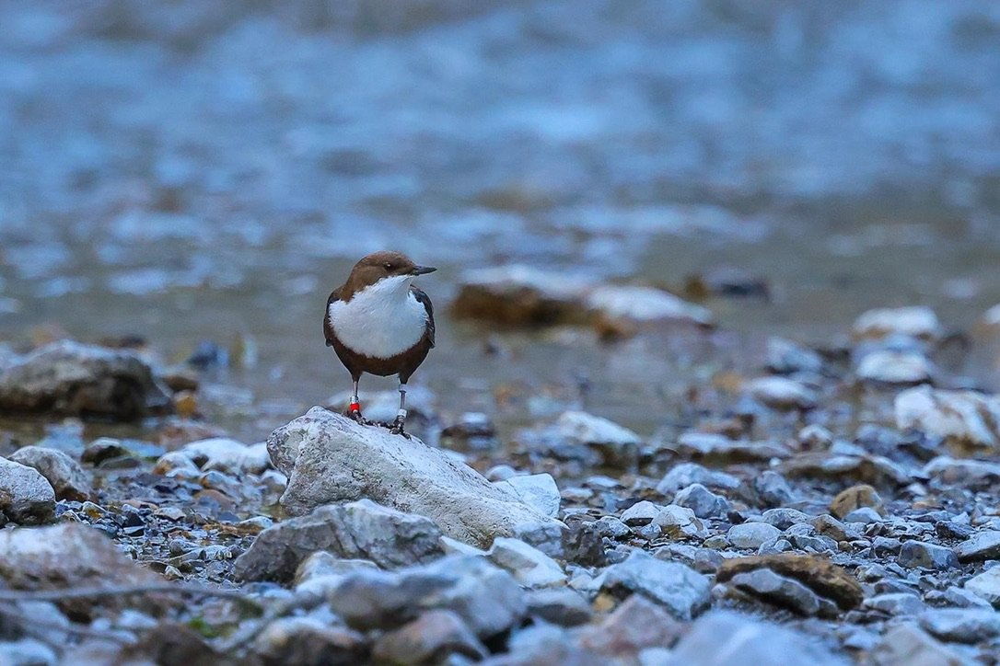

{.hero-photo fig-alt="Merlo acquaiolo con anelli colorati su un sasso lungo lo Spöl"}

[Il merlo acquaiolo – in romancio *Merl da l'Ova* – vive tutto l’anno lungo lo Spöl. È l’unico uccello canoro che si immerge per cercare larve di insetti sul fondo del torrente. Lo seguiamo durante e dopo il risanamento dello Spöl per capire come sta. **Per questo abbiamo bisogno delle vostre osservazioni.**]{.lead}

[Visto un merlo acquaiolo? Segnalatelo](osservazione.qmd){.cta}
[Il risanamento](#sanierung){.cta .secondary}

## Il risanamento dello Spöl {#sanierung}

Lo Spöl scorre dal lago di Livigno attraverso il Parco Nazionale Svizzero. Nell’autunno 2016, durante lavori anticorrosione sulla diga di Punt dal Gall, dei policlorobifenili (PCB) sono finiti nel torrente. I PCB sono inquinanti persistenti che si accumulano nei sedimenti e, attraverso la catena alimentare, negli animali.

::: {.timeline}
::: {}
**2016** – Durante lavori sulla diga di Punt dal Gall, dei PCB finiscono nello Spöl.
:::
::: {}
**Agosto 2025** – Lavori preparatori: area di cantiere presso la diga, trasferimento di circa 12 000 pesci. Il sentiero a partire dalla diga resta chiuso almeno fino alla fine del 2026.
:::
::: {}
**Dalla primavera 2026** – Su circa 3 km (tratti 1–3) il letto del torrente viene scavato. Il sedimento fine contaminato viene separato e smaltito termicamente, il materiale pulito torna nel torrente.
:::
::: {}
**In seguito** – Il tratto inferiore (circa 2,5 km) dovrebbe essere ripulito con piene artificiali mirate. Le autorità decideranno, sulla base di campionamenti, se risanare anche il tratto presso la foce dell’Ova dal Fuorn.
:::
:::

## Perché il merlo acquaiolo?

Il merlo acquaiolo si trova all’apice della catena alimentare del torrente. Si nutre di larve di tricotteri, plecotteri ed efemerotteri che vivono sul e nel sedimento, proprio dove si trovano i PCB. Studi condotti in Gran Bretagna e in Irlanda mostrano che i PCB sono rilevabili nelle uova del merlo acquaiolo. Per questo la specie è considerata un buon indicatore dello stato di un corso d’acqua.

Il risanamento incide inoltre fortemente sull’habitat: il letto del torrente viene rimodellato e le larve di insetti devono ricolonizzarlo. Vogliamo capire:

- I merli acquaioli restano nei loro territori o si spostano?
- Quanti sopravvivono e si riproducono durante e dopo i lavori?
- Con quale rapidità viene ricolonizzato lo Spöl risanato?

## Ogni merlo acquaiolo ha un nome

I merli acquaioli dello Spöl portano una combinazione individuale di **anelli colorati**. Grazie a questa ogni uccello può essere riconosciuto con il binocolo, senza doverlo ricatturare. Ogni individuo ha un nome. Ogni lettura ci dice che un determinato uccello vive in un determinato luogo.

## Come si chiama questo merlo acquaiolo? {#name-finden}

Ha letto gli anelli colorati di un merlo acquaiolo? Li scelga qui e scopra come si chiama l’uccello.

```{=html}
<div id="dipper-finder" data-mode="lookup"></div>
<script src="../assets/finder.js"></script>
```

## Come potete aiutarci

::: {.steps}
::: {}
[1]{.num}

**Osservare.** Guardate le zampe con il binocolo: quali colori porta la zampa sinistra e quale la destra, sopra e sotto?
:::
::: {}
[2]{.num}

**Scegliere gli anelli.** Cliccate i colori nel finder: vedrete subito di quale merlo acquaiolo potrebbe trattarsi, con il suo nome.
:::
::: {}
[3]{.num}

**Segnalare.** Indicate il luogo sulla carta, la data e i vostri contatti e inviate. Anche le osservazioni senza anelli riconosciuti sono preziose!
:::
:::

[Al finder e al modulo di segnalazione](osservazione.qmd){.cta}

::: {.callout-note}
## Da notare
Nel Parco Nazionale vale la regola: restare sui sentieri e non disturbare gli animali. Durante il risanamento il sentiero lungo lo Spöl a partire dalla diga di Punt dal Gall è chiuso. Osservate i siti di nidificazione solo a distanza.
:::

## Team del progetto e partner {#team}

Il progetto sul merlo acquaiolo è diretto dal **[Prof. Lukas Keller](https://www.ieu.uzh.ch/en/research/evolbiol/natural.html)** del Department of Evolutionary Biology and Environmental Studies (DEBES) dell’Università di Zurigo.

Il lavoro sul campo si svolge in collaborazione con il **Parco Nazionale Svizzero** e con il prezioso sostegno dell’instancabile team delle **guardie del parco**. Grazie di cuore!

::: {.sources}
**Fonti sul risanamento:**
[Parco Nazionale Svizzero – risanamento PCB dello Spöl](https://nationalpark.ch/spoelsanierung/) ·
[Engadiner Kraftwerke – PCB Sanierung Spöl](https://www.ekwstrom.ch/projekte/pcb-sanierung-spoel) ·
[Engadiner Post, 18.8.2025](https://www.engadinerpost.ch/news/2025/08/18/Spoel-Sanierung-Die-Vorbereitungsarbeiten-starten) ·
[SRF Regionaljournal, 30.6.2026](https://www.srf.ch/audio/regionaljournal-graubuenden/spoel-sanierung-laeuft-nach-plan?id=AUDI20260630_NR_0014)
:::
